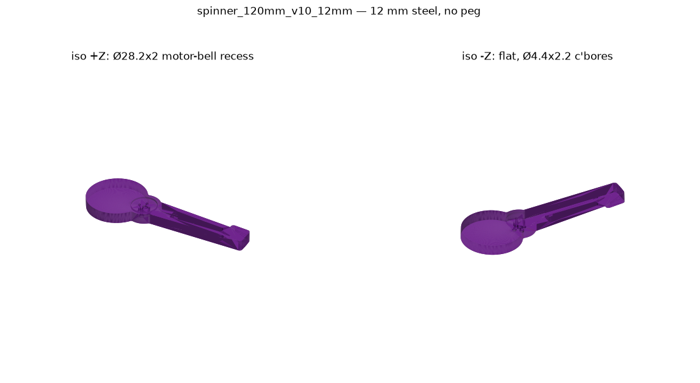

# Exterminate

A ~10 lb hobbyweight (12 lb class) computer-vision autonomous combat robot with a
12 mm steel horizontal spinner.



Build log: https://blakemakes.xyz/projects/example-project-one/

## Hardware

- **Controller:** Arduino Nano running `ExterminateRC.ino`
- **Radio:** HotRC F-06A receiver (CH1–CH3 on A1–A3)
- **Weapon:** 12 mm steel spinner, Readytosky S40 ESC on D3
- **Drive:** TB6612 motor driver
- **Vision:** Raspberry Pi 5 person tracker, talking to the Nano over USB serial
- **Power:** 850 mAh 3S LiPo

See [docs/wiring.md](docs/wiring.md) for the perfboard and wiring.

## Repo layout

```
firmware/ExterminateRC/     Nano firmware: RC drive + weapon, with Pi serial fallback
vision/                     Pi tracker scripts (face_track, person_track, track_turn)
vision/face_drive/          Drive-only bench test firmware for face_track.py
cad/spinner/                Current weapon (v10, 12 mm, no peg, motor recess) STEP/STL + spinner.py generator
cad/spinner/alternates/     Twin-hammer 12 mm v2 concepts + generator scripts
cad/mounts/                 Weapon mount and camera mount STEP (+ camera mount print STL)
Bearing_608_22x8x7.step     608 bearing model (generated by bearing608.py)
docs/                       Wiring notes and images
```

## Flashing the firmware

1. Open `firmware/ExterminateRC/ExterminateRC.ino` in the Arduino IDE (keep the
   folder name; Arduino requires it to match the sketch).
2. Board: **Arduino Nano**, Processor: **ATmega328P** (use **Old Bootloader** if
   upload fails on a CH340 clone).
3. Select the Nano's port and click **Upload**.

RC has priority. When the remote is off, the Nano accepts `M <left> <right>` /
`S` commands over serial at 115200 baud from the Pi.

**Safety:** remove the spinner and get the wheels off the ground for bench tests,
and unplug the LiPo when not testing.

## Running the tracker on the Pi

On Raspberry Pi OS Bookworm:

```bash
sudo apt install -y python3-opencv python3-picamera2 python3-serial
sudo usermod -aG dialout $USER   # then log out and back in
cd vision
python3 face_track.py --dry-run           # no serial, just print commands
python3 face_track.py --port /dev/ttyUSB0 # real run
python3 person_track.py                   # whole-person tracker (HOG)
```

`person_track.py` and `track_turn.py` serve an MJPEG preview on port 8000.
`track_turn.py` also needs `ultralytics` (YOLO). See
[vision/README.md](vision/README.md) for options and the serial protocol.
